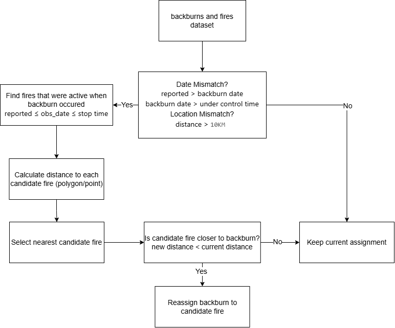
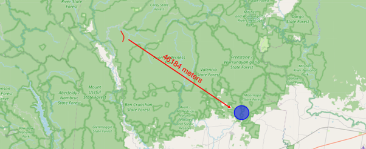
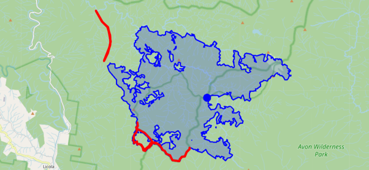
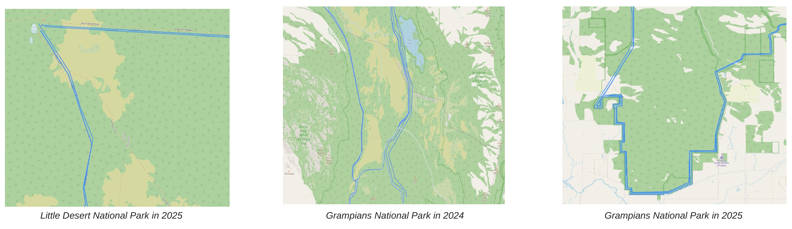
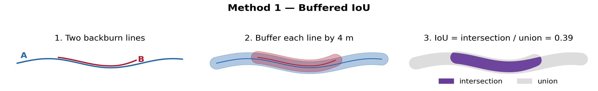
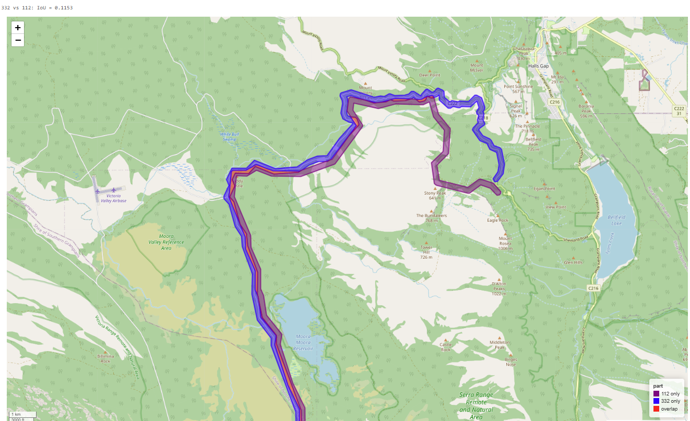
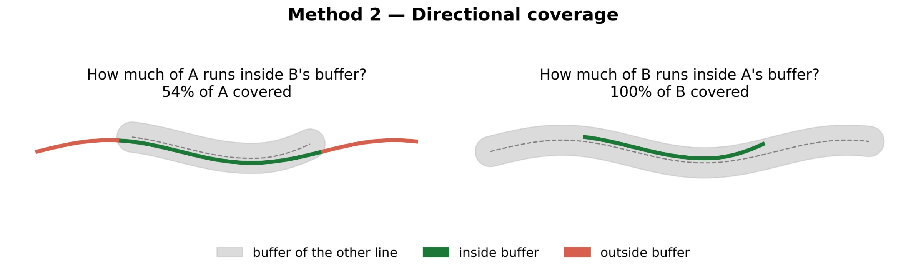
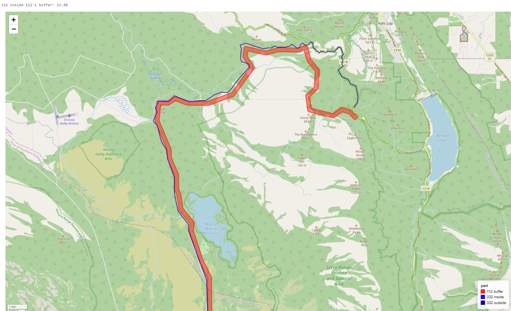
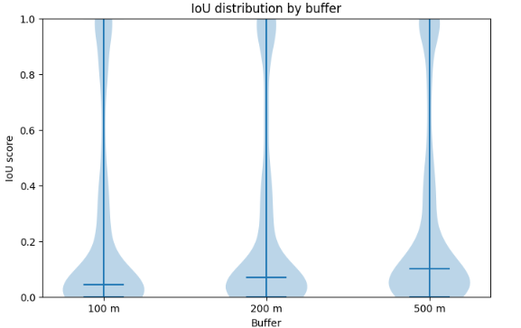

## Introduction

This report presents a data-quality project undertaken as part of an internship with the Department of Energy, Environment and Climate Action (DEECA). The project focuses on improving the reliability of an existing backburn dataset through spatial and temporal analysis, with the goal of developing a more systematic and reproducible approach to data cleaning and validation. The aim of this project is to provide AFS with a comprehensive backburn dataset to support future analysis of backburn effectiveness using topography, elevation, weather, and wind data.

This document provides an overview of the initial data, methodology applied, and the results and limitations of the approaches developed throughout this project.

## Organisation and Project Context

This internship was provided to us through DEECA. The Department of Energy, Environment and Climate Action is a government department in Victoria, responsible for managing the state's energy, environment, water, agriculture, forestry, climate action, and public land resources. One of their key responsibilities is reducing the impacts of bushfire, mainly on people, property, and the environment.

Within DEECA, Bushfire and Forest Services (BFS) plays a central role in managing approximately 3.2 million hectares of public forest all across Victoria. Their work ranges from public land law enforcement, preservation of communities and cultural values to bushfire prevention, preparedness, and response. 

This internship project is positioned within the Knowledge Planning and Risk team of BFS. In this project we focus specifically on improving the quality and reliability of an existing backburn dataset to support future analysis. The project therefore contributes to the broader bushfire-management function by developing a reproducible pipeline for validating and cleaning backburn records, providing a stronger foundation for future spatial and operational analysis of backburning and its effectiveness. The work was carried out for the Applied Fire Sciences (AFS) team, which uses spatial data and fire records to study how fires behave and how suppression tactics perform.

## Background

### 3.1 How Victoria is divided for fire management

For fire and fuel management, DEECA divides Victoria into six regions: Barwon South West, Gippsland, Grampians, Hume, Loddon Mallee and Port Phillip, each split into districts. CFA uses five regions of its own [@jfmp2025]. The regions range from semi-arid mallee in Loddon Mallee to wet forest in Port Phillip and alpine country in Hume, and these differences shape where and how backburning is used [@penman2025].

The Grampians region is also where the duplicate problem was most visible. The national park has burnt in consecutive seasons, and backburns from different fires often follow the same roads, tracks and ridgelines.

### 3.2 DEECA and CFA working together

Bushfires often spread across both public and private land. A fire that starts in a state forest can run into farmland and towns, and one that starts on private land can move into a national park. Victoria's two main fire agencies, DEECA (through FFMVic) and CFA, therefore plan and respond together.

The legislative split is based on distance from public land. Burns on public land, or within 1.5 km of it, fall within DEECA's scope; further out, CFA is the lead agency. Under the Safer Together program, the two agencies prepare a Joint Fuel Management Program for each region, share staff, equipment and training, and build strategic fuel break networks across public and private land [@safertogether; @jfmp2025]. @penman2025 drew their expert panel from both agencies, because the people who decide where and when to backburn come from CFA and DEECA alike.

This collaboration is central to backburn data. During a large fire, a backburn may be planned by one agency, lit by crews from another and mapped by a third party. Each step can create its own record. That shared, multi-agency workflow is one likely reason the same backburn appears more than once in the dataset, and it is why a clean, deduplicated record is useful to both agencies.

### 3.3 Managing Bushfires in Victoria

Bushfires are a common seasonal feature in Australian landscape and present significant risk to people, infrastructure, and the environment including its natural resources. Bushfire management generally involves a combination of prevention and preparation activities to minimize the impact of these fires. The effectiveness of these activities vary considerably depending on environmental and operational conditions, including vegetation, fuel density, terrain, weather, and many more. 

Bushfire management does not follow a single intervention, often a range of approaches may be used before and during bushfire events. These include planned fuel reductions burns, Construction of strategic fuel breaks, and backburning. While these approaches all involve the management of vegetation and fuel, they differ in their objectives, timing, and operational application. This report focuses specifically on backburning, a fire-suppression technique undertaken in response to an active bushfire.


### 3.4 What is Backburning 

Backburning is a fire suppression technique used in response to an active bushfire. Backburning involves deliberately lighting a fire close to the edge of an existing bushfire to consume the fuel between the bushfire and an established control line. Backburning can stop the bushfire from spreading and create conditions that allow firefighters to complete suppression activities safely.

Backburning generally requires an existing or constructed control line from which the fire can safely be ignited. Control lines can be in the form of dirt tracks, water bodies, SFBs, or other natural and constructed landscape features. In the case where an appropriate boundary does not exist, machinery or hand tools may be used to create one. Aerial ignition may also be used to support backburning where appropriate. 

Although both backburning and fuel reduction burning involve the deliberate use of fire to remove fuel, they serve different operational purposes. Fuel reduction burns are conducted in advance under planned conditions, in comparison, backburning is a response to an active bushfire and may have to be undertaken across a wider range of environmental conditions.

Like fuel reduction burns, backburning introduces its own set of operational risks. The technique deliberately introduces additional fire during conditions that may already support bushfire spread, an escaped backburn can increase the total area that requires containment. Experienced personnel, appropriate resources, suitable weather conditions, and careful planning are of the utmost importance for its safe application. Planning opportunities may also need to be identified early during a fire because executing a backburn takes time. 

It is also important to highlight the ecological trade-offs of backburning. Wildlife which can normally flee a fire front can become trapped between an advancing bushfire and a backburn. Backburning can also lead to the destruction of fire-sensitive biological communities. Unfortunately, ecologically vulnerable areas have previously been sacrificed to protect lives and property. Decisions regarding backburning therefore is a huge balancing act between protecting human life and property, achieving suppression objectives, and reducing environmental impacts.

### 3.5 Operational Challenges and Effectiveness of Backburning

Backburning is effective when it works, but it is one of the riskiest suppression tactics. The Tasmania Parks and Wildlife Service [@parkstas] and the sources above identify several challenges:

- **Escape.** A backburn that escapes adds to the area that must be contained, and can make the fire worse.
- **Crew safety.** Firefighters light fire under bushfire conditions, close to an active fire front.
- **Experience and resources.** Safe backburning needs experienced personnel and many crews and appliances at once.
- **A suitable control line.** The burn must be lit from a break such as a track, river or paddock. Where none exists, building one takes time, and hand-built lines are narrower and riskier.
- **Weather.** Suitable conditions must hold for the whole operation and line up with resource availability. @penman2025 found that the likelihood of using a fuel break for suppression falls as fire danger rises, partly because backburning from it becomes harder.
- **Timing.** Planning takes time, so options must be identified early. Incident teams also tend to avoid backburning because it temporarily makes the fire bigger.
- **Ecological cost.** Backburns can trap wildlife, burn unburnt refuges and damage fire-sensitive vegetation.

Every one of these challenges is shaped by place: the terrain, the fuel, the wind and the condition of the control line.

These factors mean the effectiveness of a backburn cannot be assessed from the backburn record alone. Instead, its spatial and temporal relationship with the associated bushfire, together with environmental conditions at the time and place of the event, needs to be considered. Therefore, it is important to maintain accurate records of backburn operations and the fire incidents each backburn is associated to. 

### 3.6 Importance of Reliable Backburn Data

Despite how often backburns are used, there is little empirical evidence on how well they work. @penman2025 note that it is hard to separate the effect of fuel breaks from ongoing suppression activity, that data are rarely collected during extreme fire weather, and that current suppression models do not capture decisions such as night-time backburning. Fire managers therefore rely largely on experience and expert judgement when choosing where and when to backburn.

Reliable historic backburn data is important for understanding how backburning has been used in the past and how effective it was during a bushfire. Inaccurate fire associations and duplicate records would affect subsequent analysis and result in misleading conclusions. Development of a systematic pipeline in advance to validate and clean these backburn records is therefore important before resources are allocated towards more detailed analysis. A consistent and reliable dataset provides a stronger foundation for examining the relationship between backburning and factors such as fire severity, weather, terrain, and other environmental features as well as various operational challenges. The long-term goal is to help DEECA and CFA plan backburns that are more likely to succeed and less likely to cause harm.

### 3.7 Research questions the data can answer

Once the backburn records have been validated, reassigned where necessary, and grouped to account for duplicate or similar observations, the cleaned dataset can support further analysis such as:

1. **Did the fire cross the backburn?** Each backburn line can be overlaid on the final fire polygon (`Incident_geometry`). If the fire's footprint extends well beyond the line on the side it was meant to protect, the backburn likely failed to hold. If the footprint stops at or near the line, it likely held. Because a backburn's own burnt area becomes part of the final fire, the test should measure how far the fire reaches past the line on the protected side, not simply whether the line sits inside the polygon.
2. **How much of the line held?** Long backburns can hold in some sections and fail in others. The proportion of line length that was overrun gives a continuous measure of success.
3. **Do completed backburns differ from planned ones?** The `eMap_obs_type` field separates planned and completed observations, so the dataset can show how often planned lines were carried out and where they changed.
4. **Where and when are backburns used?** Counts by region, vegetation type and fire danger show where the tactic is relied on most.

## Dataset and Initial Data Analysis

### 4.1 Dataset Overview

The dataset used in this project contains 396 backburn records matched to bushfire incidents in the Victorian Wildfire Research Database (VWFRD). Each record combines important information about the backburn and its associated fire incident, including dates, backburn vectors, incident geometries, incident timing, and the distance between the backburn and the fire. These backburns were initially matched to fire incidents either through pre-existing fire Identifiers in the backburns data or through early attempts at geospatial matching.

### 4.2 Variables and Data Structure

```{r}
#| echo: false
#| label: tbl-vars
#| tbl-cap: "Variables included in the backburns dataset."

library(knitr)
library(tibble)

variables_table <- tribble(
  ~`Column name`, ~Type, ~Description,
  "eMap_obs_date", "datetime", "Date of backburn observation.",
  "backburn_geometry", "LineString / MultiLineString", "Backburn geometry, stored as lines.",
  "eMap_obs_type", "string", "Type of observation (BackburnPlanned or BackburnCompleted).",
  "vwfrd_id", "int", "Fire ID in the Victorian Wildfire Research Database (VWFRD).",
  "vwfrd_fire_name", "string", "Fire name in VWFRD.",
  "reported_time", "datetime", "Time that the fire was first reported.",
  "under_control_time", "datetime", "Time that the fire was deemed under control.",
  "stop_time", "datetime", "Time that the fire was stopped or extinguished.",
  "Incident_geometry", "Polygon / MultiPolygon", "Final fire polygon.",
  "distance", "float", "Minimum distance between a backburn and the fire it is linked to.",
  "point", "Point geometry", "Point location associated with the fire incident."
)

kable(variables_table)
```

The dataset contains a wide range of variables describing both the backburn observation and the fire incident it is associated to. However, only the variables relevant to this project and report are presented in @tbl-vars. Backburn-specific information includes observation date, observation type, and backburn geometry, while fire incident information includes VWFRD identifier, fire name, incident timing, point location, and incident geometry. The dataset also includes the minimum distance between each backburn and its matched fire incident. It is important to note that incident geometry is not available for every fire. Where this geometry is missing, the distance between the backburn and the associated fire cannot be calculated, leaving the distance value empty for those records.

### 4.3 Spatial Representation of Backburn and Fire Records

The dataset contains spatial representations of both backburn operations and fire incidents. Backburns are stored as line geometries, while fire incidents are represented as polygons. Each incident also contains an associated point geometry.

These geometry types are important as they allow us to assess the spatial relationship between a backburn and its associated fire. A backburn located a considerable distance from its matched fire may indicate incorrect association, while multiple overlapping backburn records with similar line geometries may represent the same or related operation. Geospatial analysis therefore provides an important basis for identifying inconsistencies and validating records in this project.

### 4.4 Initial Data Analysis {#sec-ida}

To identify potentially incorrect backburn to fire associations, two validation flags were created. A location mismatch was identified when the distance between a backburn to its fire exceeded 10 km, while a date mismatch was identified when the backburn occurred before the fire was reported or after the fire was recorded as under control.

```{r}
#| label: tbl-initial-mismatches
#| tbl-cap: "Initial mismatch flag counts"
#| echo: false

library(tibble)
library(knitr)


mismatch_initial_table <- tribble(
  ~Mismatch_Status, ~location_mismatch, ~date_mismatch, ~any_mismatch,
  "False",          339,                342,            288,
  "True",           57,                 54,             108
)

kable(
  mismatch_initial_table,
  col.names = c(
    "Mismatch status",
    "Location mismatch",
    "Date mismatch",
    "Any mismatch"
  ),
  align = "lrrr"
)
```

As shown in @tbl-initial-mismatches, 57 records were identified as location mismatches and 54 as date mismatches, with a total of 108 records flagged by at least one validation rule.

We then examined the temporal relationship between backburns and their associated fires, records were classified according to when they occurred within the fire timeline. @tbl-time-category shows the resulting categories.

```{r}
#| label: tbl-time-category
#| tbl-cap: "Timing of backburn observations relative to stop time"
#| echo: false

time_category_table <- tribble(
  ~Time_Category,                 ~Count,
  "Under Control Not Stopped",    42,
  "0-7 Days After Stop",           9,
  "31-180 Days After Stop",        1,
  ">180 Days After Stop",          1,
  "8-30 Days After Stop",          1
)

kable(
  time_category_table,
  col.names = c(
    "Time category",
    "Count"
  ),
  align = "lr"
)
```

Out of the 54 date mismatches, 42 backburns occurred after the fire had been deemed under control but before the incident was officially stopped, some records occurred considerably later. Review of individual incidents also revealed that multiple fires shared identical or highly similar reported, under control, and stop times. These observations suggested that incident-status information may not always represent the operational progression of a fire.

Initial inspection also identified several limitations within the source data. Some incidents did not contain an incident polygon despite having an associated point location, this results in missing distance values. Visual inspection of the backburn geometries further indicated that many records overlapped substantially and appeared to represent the same or closely related operations. Together, these observations highlighted two key data-quality issues within the dataset: potentially incorrect fire associations and potentially duplicated backburn records. These issues motivated the validation and grouping methodologies described in @sec-methodology.

## Data cleaning and Validation Methodology {#sec-methodology}

### 5.1 Overview

The dataset presented two primary data-quality challenges. First, some backburn records appeared to be associated with the incorrect fire incident. Second, multiple records appeared to represent the same backburn operation. To address these issues, the project was divided into two complementary workflows: (1) backburn-fire reassignment and (2) backburn grouping.

### 5.2 Backburn-Fire Reassignment {#sec-reassignment}

The validation process described in the previous section identified a subset of backburn records whose association with a fire incident appeared questionable. Records were flagged when they exhibited either a suspicious spatial relationship or a suspicious temporal relationship with their assigned fire. A spatial flag was applied if a backburn was located more than 10 km from the associated fire incident, while a temporal flag was applied if the backburn occurred before the fire was reported or after it was deemed under control. To improve the reliability of this dataset, a reassignment procedure was developed to evaluate whether a more plausible fire incident could be identified for this subset of records.

The process combines both temporal and spatial information. For each flagged backburn, candidate fire incidents are first identified based on whether they were active when the backburn was recorded. The distance between the backburn and these candidate incidents would then be calculated using available backburn and incident geometries, if incident geometry was not available, we default to using the fire point. The nearest candidate fire would then be compared with the currently assigned fire; reassignment occurs if the candidate fire provides a better spatial match.
When a backburn is reassigned to a new fire, all fire-related attributes associated with the backburn are updated to reflect the newly assigned incident. Validation flags are subsequently recalculated using the updated information to ensure consistency. The overall reassignment workflow is shown in @fig-reassignment-workflow.

{#fig-reassignment-workflow width=100% height=100%}

#### 5.2.1 Identifying Candidate Fire Incidents

Once a backburn has been flagged for review, a set of candidate fire incidents was identified. This step was to establish which fires could plausibly be associated with the backburn before any spatial comparison was performed. Candidate fires were selected using the observation date of the backburn and the recorded timeline of each fire incident. If the backburn observation occurred between the fire’s reported time and stop time, we consider that fire a valid candidate. 
Stop time was used instead of under control time because a fire may continue to burn or require management activities after it as been declared under control. In practice, fire behaviour and incident status records do not always align. A fire may become active again following a period of containment, while the incident status is not immediately updated to reflect this change. 

Filtering fire incidents significantly reduced the number of candidates to be considered for each reassignment; it allows subsequent spatial analysis to focus only on temporally plausible candidates.

#### 5.2.2 Evaluating Candidate Fire Incidents

Now that we have a set of candidate fires, the spatial relationship between the backburn and each of these fires need to be assessed. The goal is to identify which candidate provides the closes spatial match to the backburn. 

For each candidate fire, the minimum distance between the backburn geometry and the fire incident was calculated. When fire geometry was available, the distance was measured directly between the backburn line and the fire polygon. This was the preferred approach as it represented the recorded extent of the fire and therefore provided the most spatially accurate comparison.

When incident polygons were not available, we would default to using the incident point location associated with the fire. The point geometry was project into the same coordinate reference system as the backburn geometry, creating the variable, point_proj. This ensured all distance calculations were performed within a common projected coordinate system, and all candidate fires could be evaluated regardless of the availability of a polygon.

After distances had been calculated for all fires, the candidate with the smallest distance to the backburn was selected as the nearest fire. This candidate represented the most spatially plausible alternative association and was subsequently compared with the fire currently assigned to the backburn.

#### 5.2.3 Reassignment Criteria

Compare the nearest identified candidate fire with the fire currently associated with the backburn. This is to determine whether the alternative represented a genuinely better match than the current fire. 

For each flagged backburn, the distance between the backburn and its associated fire was compared with the distance to the nearest candidate fire identified in the previous step. Reassignment occurs when the candidate fire was closer to the backburn that the current fire by more than a user-defined improvement threshold. 

This threshold is currently set at one meter; it can be adjusted depending on the desired level of conservatism in the reassignment process. Larger thresholds require a greater improvement in spatial proximity before reassignment can occur, while smaller thresholds result in a more sensitive reassignment procedure.

The reassignment criterion can be expressed as:

```{r}
#| echo: false
#| output: asis

cat("$$\\text{nearest\\_distance} + T < \\text{current\\_distance}$$")
```
Where $T$ represents the minimum improvement threshold. For this project, $T = 1$ metre.

If this condition was satisfied, the candidate fire was deemed a better spatial match and the backburn was reassigned. Otherwise, the existing association was retained. This approach ensures reassignment decisions are driven by meaningful improvements in spatial proximity while retaining flexibility for future applications of the workflow.

#### 5.2.4 Updating Fire Attributes
When a backburn is reassigned, the fire association of the backburn is updated to reflect the newly selected incident.  Consequently, all fire-related attributes were replaced with the corresponding values from the newly assigned fire. 

The updated attributes include the fire identifier (`vwfrd_id`), fire name (`vwfrd_fire_name`), fire geometry (`incident_geometry`), incident point location (`point` and `point_proj`), and the incident timeline (`reported_time`, `under_control_time`, and `stop_time`). The distance between the backburn and the assigned fire is also recalculated and updated.

Following reassignment, spatial and temporal mismatch flags, described in @sec-reassignment, were also recalculated. Doing this ensures that validation results reflected the final fire assignment rather than original association. 

Time-based classifications were also regenerated using the updated incident timeline. Recalculating categories ensured that any subsequent analysis of backburn timing was based on the final fire association and remained consistent with the reassigned incident information.

This step ensures all variables derived from the associated fire incident remained internally consistent after reassignment and prevented records from retaining attributes from a previous fire association.

#### Example of a Backburn Reassignment

{#fig-mismatched-backburn width=100%}

@fig-mismatched-backburn shows a backburn originally matched to MACALISTER 57 - BRIAGOLONG - BLUE POOL, resulting in a distance of approximately 46 km between the backburn and the fire. This large distance caused the record to be flagged as a potential location mismatch. In addition, this backburn also occurred almost a year after the fire’s recorded under control date, which also makes it a date mismatch. 

{#fig-reassigned-backburn width=100%}

@fig-reassigned-backburn shows the same backburn after reassignment to MACALISTER 57 - LICOLA - MT MARGARET TK. This reduced the distance between the backburn and incident to approximately 409 m while also remaining consistent with the fire timeline. The improved spatial alignment suggests that the reassigned fire provides a more plausible association for this backburn record. 

```{r}
#| label: tbl-reassignment-example
#| tbl-cap: "Example of a backburn reassigned to a closer fire incident"
#| echo: false

library(tibble)
library(knitr)

reassignment_table <- tribble(
  ~Match,           ~Observation_Date, ~Fire_Name,                                    ~Reported_Time, ~Under_Control_Time, ~Distance_m,
  "Initial match",  "2025-03-10",      "MACALISTER 57 - BRIAGOLONG - BLUE POOL",       "2024-03-31",   "2024-03-31",        46184.82,
  "Candidate match",  "2025-03-10",      "MACALISTER 57 - LICOLA - MT MARGARET TK",      "2025-02-23",   "2025-03-16",          408.80
)

kable(
  reassignment_table,
  col.names = c(
    "Match",
    "Observation date",
    "Fire name",
    "Reported time",
    "Under control time",
    "Distance (m)"
  ),
  align = "lllcllr",
  digits = 2
)
```

@tbl-reassignment-example provides a summary of the reassignment, showing the substantial reduction in distance as well as the updated incident timeline. 

### 5.3 Grouping Duplicate Backburns

This section of the report covers the second problem: the same backburn appearing multiple times. Duplicates were not exact copies. Two records of one backburn could differ in length, start and end points, vertex positions and date. One might cover the full line while another covers only one section. In some places, lines from different fires also sat almost on top of each other because crews reused the same roads and tracks (@fig-duplicates).

{#fig-duplicates fig-alt="Three maps showing duplicate and overlapping backburn lines in Little Desert and Grampians National Parks"}

The task was to decide, for every pair of records, whether they describe the same backburn, and then to assign each record to a group.

#### 5.3.1 Using a Buffer instead of a Radius

The simplest way to group spatial records is by distance: pick a radius, and treat any records whose centres (or nearest points) fall within that radius as one group. This works for point data, such as ignition locations. It does not work well for backburns, for three reasons.

**Backburns are long lines, not points.** A single backburn can run for several kilometres. Its centroid may sit far from any part of the line, and two records of the same backburn can have quite different centroids if one covers only half the route. A radius small enough to separate nearby fires would split these records apart. A radius large enough to join them would also capture unrelated lines.

**Being close is not the same as following the same path.** Two backburns from different fires can cross each other or meet at a junction. Their nearest points are then zero metres apart, so a radius rule groups them, even though they share almost none of their route. In the Grampians, where fires in 2024 and 2025 used the same road network, this would merge backburns from different fires into one group.

**A radius ignores shape and direction.** Two parallel lines on opposite sides of a valley can have centroids only a few hundred metres apart while following different ridges. A radius cannot tell these apart from two copies of one line.

Drawing a band of fixed width $d$ around each line turns it into a corridor, and comparing corridors asks whether two lines follow the same path along their length, within a tolerance of $d$. Lines that only cross or touch share a small patch of corridor. Lines that run in parallel further apart than $2d$ share none. Lines that trace the same route share most of their corridor.

The buffer width also has a physical meaning. It is the tolerance for the differences expected between two maps of the same backburn: GPS error, hand-drawn lines on maps at different scales, lines snapped to a road on one map and to the burn edge on another. Choosing $d$ therefore means asking how far apart two records can be and still describe the same operation.

We developed two ways to score the overlap of buffered lines, and then combined them.

#### 5.3.2 Method 1: Buffered IoU

Intersection over Union (IoU) is a standard similarity measure in spatial analysis and computer vision. Each line is buffered by $d$, and the score is the area the two corridors share divided by the area they cover together:

$$
\text{IoU}(A, B) = \frac{\operatorname{area}\big(\operatorname{buf}(A, d) \cap \operatorname{buf}(B, d)\big)}{\operatorname{area}\big(\operatorname{buf}(A, d) \cup \operatorname{buf}(B, d)\big)}
$$ {#eq-iou}

The score runs from 0 (no overlap) to 1 (identical corridors).

{#fig-iou-schematic fig-alt="Schematic of buffered IoU with two lines, their buffers, and the intersection over the union"}

IoU was chosen first for its simplicity. It is symmetric, so the score for A against B equals the score for B against A. It produces one number per pair on a fixed scale, and it is easy to explain to people who do not work with spatial data.

Its weakness is that the score does not say much on its own when one line is part of another. Suppose line A is one quarter the length of line B and lies entirely along B. Every part of A is a duplicate of part of B, yet the union is roughly the size of B's corridor, and the intersection is only A's corridor. The IoU is therefore close to 0.25, a low score for a true subset. In general, the IoU of a subset is close to the ratio of the two line lengths, however perfectly the shorter line matches.

This matters for backburns because subsets are common. A planned line may be recorded in full and only part of it later recorded as completed, or a backburn may be mapped in sections.

{#fig-iou-example fig-alt="Map of backburns 332 and 112 showing the overlapping and unique sections"}

#### 5.3.3 Method 2: Directional coverage

Directional coverage asks a narrower question: how much of one line runs inside the other line's corridor? Only one line is buffered at a time, and the score is measured as a share of the other line's length:

$$
C(A \rightarrow B) = \frac{\operatorname{length}\big(A \cap \operatorname{buf}(B, d)\big)}{\operatorname{length}(A)}
$$ {#eq-cov-dir}

The calculation is then repeated in the other direction, and the larger value is kept:

$$
\text{Coverage}(A, B) = \max\big(C(A \rightarrow B),\; C(B \rightarrow A)\big)
$$ {#eq-cov}

{#fig-cov-schematic fig-alt="Schematic of directional coverage in both directions"}

Taking the maximum solves the subset problem. In the earlier example, where A is a quarter of B and lies along it, all of A falls inside B's corridor, so the coverage is 100%. The shorter line is correctly recognised as a duplicate of part of the longer one.

Measuring length instead of area also has a practical benefit. Coverage does not depend on the buffer's end caps or on how the two corridors overlap at bends, so it is less affected by line shape than IoU.

{#fig-cov-example fig-alt="Map showing the part of backburn 332 inside backburn 112's buffer"}

#### 5.3.4 Using the Length Ratio

High coverage shows that one line follows the other. It does not show whether the two records describe the whole backburn twice or one record describes only part of it. A length ratio fills that gap:

$$
\text{LR}(A, B) = \frac{\min\big(\operatorname{length}(A), \operatorname{length}(B)\big)}{\max\big(\operatorname{length}(A), \operatorname{length}(B)\big)}
$$ {#eq-lr}

Read together, coverage and length ratio separate three cases (@tbl-lr).

| Coverage | Length ratio | Interpretation |
|---|---|---|
| High | Close to 1 | Near duplicate: the same backburn recorded twice |
| High | Low | Subset: one record covers only a section of the other |
| Low | Any | Different backburns that may cross or touch |

: Reading coverage and length ratio together {#tbl-lr tbl-colwidths="[18,22,60]"}

This distinction is useful beyond grouping. For example, a completed record that is a subset of a planned record may show that only part of a planned line was actually burnt.

#### 5.3.5 A Combination of Both Methods

Neither score is enough on its own. IoU under-scores subsets. Coverage can over-score short pieces: a stub of a few hundred metres that crosses or touches a long line can sit almost entirely inside the long line's corridor and reach high coverage, even though the two records do not describe the same operation. Requiring both scores to pass guards against each method's blind spot.

The final grouping procedure was:

1. Buffer every backburn line by 100 m.
2. Compare every pair of backburns. With 396 records, this is 78,210 pairs.
3. Score each pair with both buffered IoU and directional coverage.
4. Link a pair when both its IoU and its coverage are above 5%.
5. Chain linked pairs into groups. If A is linked to B, and B is linked to C, then A, B and C form one group, even if A and C do not overlap directly.
6. Record each backburn's group in a new variable, `group_id`.

The 5% threshold is deliberately low. The buffer already does most of the filtering, because lines further apart than twice the buffer width score zero on both measures. The threshold only needs to remove incidental contact, such as two lines crossing at a junction.

Step 5 treats the backburns as a network, with each record a node and each link an edge. Each group is a connected component of that network. Chaining is what allows a backburn that was mapped in several overlapping sections to come together as one group, even when the first and last sections do not touch.

{#fig-groups fig-alt="Map of grouped backburns, each group drawn in a different colour"}

With a 100 m buffer, the 396 records were assigned to 104 groups (@fig-groups). Each group can now be treated as one backburn operation and linked to one fire.

## Results and Limitations

This section presents outcomes and limitations of the data-cleaning procedures described in @sec-methodology. Results are organised according to the two major challenges identified in the dataset: incorrect fire associations and potential duplicate backburn operations. The first part of this section focuses on the reassignment of backburns, while the second examines the grouping of potentially related backburn records. 

### 6.1 Fire Association Validation and Reassignment

Following validation procedures described in @sec-ida, a total of 108 backburn records were flagged for further review. These records were subsequently assessed using the reassignment procedure described in section @sec-reassignment.

#### 6.1.1 Reassignment Results

@tbl-mismatch-before-after shows the distribution of mismatch flags before and after reassignment.

```{r}
#| label: tbl-mismatch-before-after
#| tbl-cap: "Number of records flagged before and after fire reassignment"
#| echo: false

library(tibble)
library(knitr)

mismatch_table <- tribble(
  ~Mismatch_Type,       ~Before_Reassignment, ~After_Reassignment,
  "Location mismatch",  57,                   7,
  "Date mismatch",      54,                   59,
  "Any mismatch",       108,                  66
)

kable(
  mismatch_table,
  col.names = c(
    "Mismatch type",
    "Before reassignment",
    "After reassignment"
  ),
  align = "lrr"
)
```
The reassignment workflow successfully reduced the number of flagged records from 108 to 66. Most successful corrections were associated with spatial mismatches, where an alternative active fire was substantially closer to the backburn then the original assignment. In contrast, a larger proportion of temporal mismatches remained unresolved. In some cases, a record that was originally flagged as a location mismatch was reassigned to a much closer fire, resolving the spatial inconsistency, but later became flagged as a date mismatch.

#### 6.1.2 Interpretation of Remaining Temporal Mismatches

This outcome was anticipated and reflects a deliberate design choice within the algorithm. When identifying candidate fires, backburns were permitted to match to fires occurring between the reported time and stop time of an incident, rather than restricting matches to the period up to the point the fire was recorded as under control. This decision was made because incident status information does not always fully reflect the operational progression of a fire. In practice, a fire may become active again following a period of containment while recorded under control status is not updated accordingly. Restricting candidate selection to the under control period would therefore risk excluding plausible fire associations.

At the same time, the validation process intentionally flags a temporal mismatch for any backburn occurring before the reported time or after the under control time of the assigned fire. This created a more sensitive validation procedure, allowing records with potentially unusual timing to be identified and reviewed. As a result of these decisions, some reassigned records remained flagged as temporal mismatches even though they were associated with the most spatially plausible fire. Records that remain flagged should therefore be interpreted as records warranting further investigation rather than definitive evidence of an incorrect fire association. 

#### 6.1.3 Limitations of the Reassignment Method

Although the reassignment algorithm improved the consistency of fire associations within the dataset, several limitations remain. The methodology relies on the accuracy of incident information recorded in VWFRD, particularly temporal and spatial information. Fire status records do not always reflect operational changes immediately, and a fire may become active again after being recorded as under control without the incident status being updated. As a result, some records appear as temporal mismatches despite being associated with the most spatially plausible fire. Lastly, where incident polygons were unavailable, point locations were used, providing a less complete representation of fire extent. 

### 6.2 Duplicate Identification and Grouping

#### 6.2.1 Buffer width drives the result

The main finding of this work is that the grouping is only as good as the buffer width chosen. The same 396 records produced very different numbers of groups as the buffer grew (@tbl-groups).

| Buffer width | Groups formed | Change from previous width |
|---|---:|---|
| 100 m | 104 | |
| 200 m | 80 | 24 fewer (−23%) |
| 500 m | 54 | 26 fewer (−33%) |

: Number of groups formed at each buffer width {#tbl-groups}

Moving from 100 m to 500 m roughly halved the number of groups. None of the underlying records changed; only the tolerance for calling two lines the same did.

The reason is visible in the pairwise scores. @fig-violin shows the distribution of IoU scores across all pairs at each buffer width.

{#fig-violin width="80%" fig-alt="Violin plot of IoU scores for 100 m, 200 m and 500 m buffers"}

Three patterns stand out:

- **Most pairs score near zero at every width.** The bulk of each violin sits below 0.2. Most pairs of backburns are simply not near each other, which is expected in a dataset covering fires across Victoria.
- **The centre of the distribution moves up as the buffer grows.** The central line rises from about 0.04 at 100 m to about 0.07 at 200 m and about 0.10 at 500 m, and the body of the violin becomes wider in the 0.05 to 0.2 range.
- **A small group of pairs scores close to 1 at every width.** These are the clear duplicates, and they are found regardless of buffer choice.

Scores rise with the buffer because two records of the same backburn are rarely drawn in exactly the same place. With a 100 m buffer, a small offset between them can leave a gap between their bands and lower the score. At 500 m the same offset is small compared with the band, so the bands overlap more. This also happens to unrelated lines. Two lines a few hundred metres apart share nothing at 100 m but start to overlap at 500 m.

Since the 5% threshold stays the same, higher scores mean more pairs get linked, and more links chain into fewer, larger groups. A narrow buffer can miss duplicates that were mapped slightly apart, so the same backburn is counted more than once. A wide buffer can join separate backburns that ran close together, which is more likely in places like the Grampians where different fires used the same roads. The right width sits somewhere between the two.

We chose 100 m for the final method after checking the backburns one by one and plotting each group on a map. At 500 m, most backburns were merged into a few large groups, which left no room to tell separate operations apart. At 100 m, clear duplicates were grouped while nearby lines from separate operations stayed apart, which matches the expected size of mapping differences between records of one backburn.

#### 6.2.2 Only Geometry is Considered

The grouping uses line geometry alone, without the observation date, linked fire or observation type. As a result, two backburns from different fires can be grouped together if they followed the same track closely enough.

This is the main remaining risk for repeat-fire landscapes like the Grampians. A practical improvement would be to add a non-spatial condition to the linking rule, for example linking a pair only if it is matched to the same `vwfrd_id`, or if both observation dates fall within the same fire's active period. Using both geometry and time would separate a 2024 backburn from a 2025 backburn on the same road, which geometry alone cannot.

## Summary and Conclusion

This project developed a reproducible workflow to improve the quality and reliability of an existing backburns dataset by addressing two key issues: incorrect fire association and duplicate backburn records. Spatial and temporal validation initially flagged 108 backburn records for further review. Following reassignment, the number of flagged records was reduced to 66, with location mismatches decreasing from 57 to 7. The second stage used buffered Intersection over Union (IoU) and directional coverage to identify and group similar backburn records. Using a 100 m buffer, the 396 records were organised into 104 groups, providing a more structured dataset in which related observations can be considered together.

These methods provide a more systematic basis for validating, cleaning, and organizing backburn records and can be applied to future data entries. However, results remain dependent on factors such as the quality of VWFRD incident information, the selected buffer width, similarity thresholds, and temporal validation rules. Future work should validate these settings against manually reviewed records. Overall, the cleaned dataset provides AFS with a stronger foundation for future analysis of backburning and its effectiveness. 

## Repositories

The code and supporting materials developed for this project are available in the following repositories:

- [ETC5543 Project Repository](https://github.com/HJY353/ETC5543.git)
- [DEECA Backburn Dataset Repository]( https://github.com/vic-ffm/ds-back-burning-dataset.git)

## References {.unnumbered}

::: {#refs}
:::
