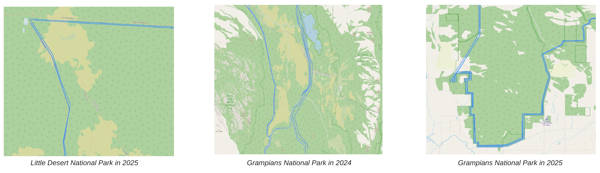
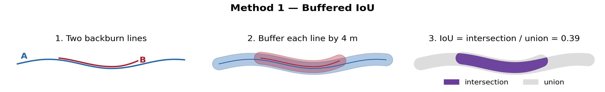
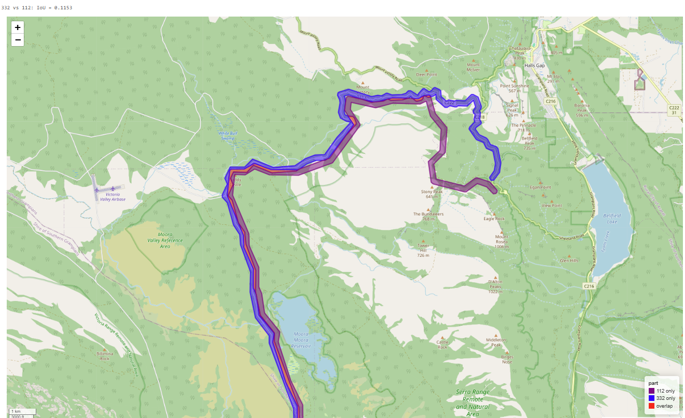
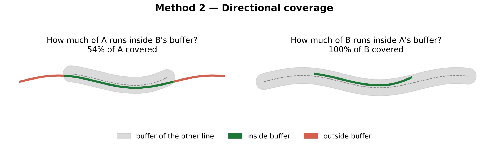
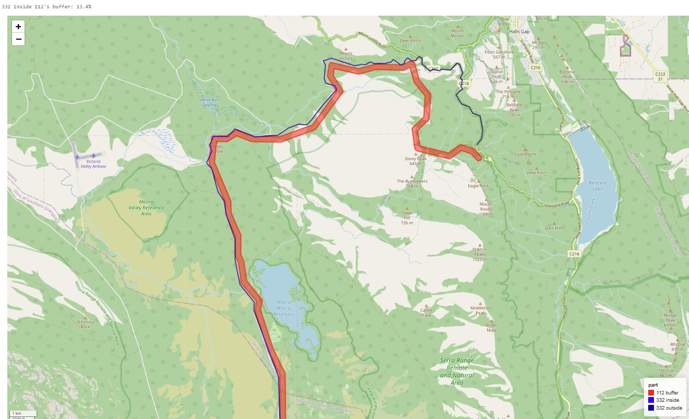
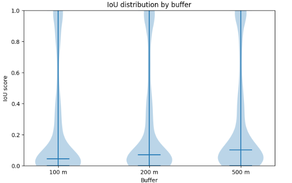

# Organisation and project context

## DEECA and its role in bushfire management

The Department of Energy, Environment and Climate Action (DEECA) is the Victorian Government department responsible for land and environment management, bushfire management, and climate and energy policy. Its stated purpose is to support thriving, productive and sustainable communities, environments and industries.

Bushfire work sits within DEECA's Bushfire and Forest Services (BFS) group. BFS protects Victoria's state forests, parks and tourism sites, leads bushfire prevention, preparation and response on public land, and works to preserve communities and culture. Within BFS, the Knowledge, Planning and Risk (KPR) area supports decisions with science, data and risk analysis. This project was carried out for the Applied Fire Sciences (AFS) team, which uses spatial data and fire records to study how fires behave and how suppression tactics perform.

On the ground, DEECA's fire operations are delivered through Forest Fire Management Victoria (FFMVic). FFMVic brings together specialist staff from DEECA, Parks Victoria and Melbourne Water [@jfmp2025].

## How Victoria is divided for fire management

For fire and fuel management, DEECA divides Victoria into six regions: Barwon South West, Gippsland, Grampians, Hume, Loddon Mallee and Port Phillip, each split into districts. CFA uses five regions of its own [@jfmp2025]. The regions range from semi-arid mallee in Loddon Mallee to wet forest in Port Phillip and alpine country in Hume, and these differences shape where and how backburning is used [@penman2025].

The Grampians region is also where the duplicate problem was most visible. The national park has burnt in consecutive seasons, and backburns from different fires often follow the same roads, tracks and ridgelines.

## DEECA and CFA working together

Bushfires often spread across both public and private land. A fire that starts in a state forest can run into farmland and towns, and one that starts on private land can move into a national park. Victoria's two main fire agencies, DEECA (through FFMVic) and CFA, therefore plan and respond together.

The legislative split is based on distance from public land. Burns on public land, or within 1.5 km of it, fall within DEECA's scope; further out, CFA is the lead agency. Under the Safer Together program, the two agencies prepare a Joint Fuel Management Program for each region, share staff, equipment and training, and build strategic fuel break networks across public and private land [@safertogether; @jfmp2025]. @penman2025 drew their expert panel from both agencies, because the people who decide where and when to backburn come from CFA and DEECA alike.

This collaboration is central to backburn data. During a large fire, a backburn may be planned by one agency, lit by crews from another and mapped by a third party. Each step can create its own record. That shared, multi-agency workflow is one likely reason the same backburn appears more than once in the dataset, and it is why a clean, deduplicated record is useful to both agencies.

## Planned burns and backburns

The two terms are often confused, but they describe different activities. @conversation compares the difference to that between elective and emergency surgery (@tbl-burns).

| | Planned (fuel reduction) burn | Backburn |
|---|---|---|
| Purpose | Lower the fuel load so future fires are less intense | Stop an active bushfire from spreading into a specific area |
| Timing | Before the fire season, in a chosen weather window | During a bushfire, often at night or in a lull in fire danger |
| How it works | Burns fine surface fuels such as leaf litter across a target area | Lit from a control line so it burns towards the main fire and removes the fuel in its path |
| Control line | Burn unit boundaries set in advance | Existing roads, tracks, firebreaks, water bodies, or lines cut by bulldozer or hand |
| Main risks | Escape, smoke, ecological harm from burning too often | Escape that adds to the fire, crew safety, wildlife trapped between fires, loss of unburnt refuges |

: Planned burns compared with backburns {#tbl-burns tbl-colwidths="[18,41,41]"}

A planned burn manages the landscape ahead of time, while a backburn is a tactical decision made under pressure during an incident. This project deals only with backburns.

## Challenges of backburning

Backburning is effective when it works, but it is one of the riskiest suppression tactics. The Tasmania Parks and Wildlife Service [@parkstas] and the sources above identify several challenges:

- **Escape.** A backburn that escapes adds to the area that must be contained, and can make the fire worse.
- **Crew safety.** Firefighters light fire under bushfire conditions, close to an active fire front.
- **Experience and resources.** Safe backburning needs experienced personnel and many crews and appliances at once.
- **A suitable control line.** The burn must be lit from a break such as a track, river or paddock. Where none exists, building one takes time, and hand-built lines are narrower and riskier.
- **Weather.** Suitable conditions must hold for the whole operation and line up with resource availability. @penman2025 found that the likelihood of using a fuel break for suppression falls as fire danger rises, partly because backburning from it becomes harder.
- **Timing.** Planning takes time, so options must be identified early. Incident teams also tend to avoid backburning because it temporarily makes the fire bigger.
- **Ecological cost.** Backburns can trap wildlife, burn unburnt refuges and damage fire-sensitive vegetation.

Every one of these challenges is shaped by place: the terrain, the fuel, the wind and the condition of the control line.

## Why this project matters

Despite how often backburns are used, there is little empirical evidence on how well they work. @penman2025 note that it is hard to separate the effect of fuel breaks from ongoing suppression activity, that data are rarely collected during extreme fire weather, and that current suppression models do not capture decisions such as night-time backburning. Fire managers therefore rely largely on experience and expert judgement when choosing where and when to backburn.

A clean backburn dataset makes it possible to learn from past fires. If each backburn is recorded once and linked to the correct fire, its line can be compared with the fire's final footprint and with the conditions on the day. Over many fires, this can show which backburns held, which failed and why. The long-term goal is to help DEECA and CFA plan backburns that are more likely to succeed and less likely to cause harm.

This is why removing duplicates comes first. If the same backburn is counted three times, any analysis gives it three times the weight. Fires with many duplicate records would dominate the results, and copies of one backburn could end up in both the training and testing data of a model, making it look more accurate than it is.

## Research questions the dataset can answer

Once grouped, the dataset can support questions such as:

1. **Did the fire cross the backburn?** Each backburn line can be overlaid on the final fire polygon (`Incident_geometry`). If the fire's footprint extends well beyond the line on the side it was meant to protect, the backburn likely failed to hold. If the footprint stops at or near the line, it likely held. Because a backburn's own burnt area becomes part of the final fire, the test should measure how far the fire reaches past the line on the protected side, not simply whether the line sits inside the polygon.
2. **How much of the line held?** Long backburns can hold in some sections and fail in others. The proportion of line length that was overrun gives a continuous measure of success.
3. **Do completed backburns differ from planned ones?** The `eMap_obs_type` field separates planned and completed observations, so the dataset can show how often planned lines were carried out and where they changed.
4. **Where and when are backburns used?** Counts by region, vegetation type and fire danger show where the tactic is relied on most.

## Scope for a backburn success model

The questions above lead to a predictive model of backburn success. We propose the following scope for that next stage.

**Unit of analysis.** One grouped backburn (one `group_id`) linked to one fire. Using groups instead of raw records avoids counting the same operation more than once.

**Outcome.** A binary label (held or breached) from question 1, with the proportion of line overrun as an alternative continuous outcome.

**Predictors.** Spatial and environmental layers sampled along each backburn line and its surroundings:

- **Terrain:** elevation, slope and aspect. Fire runs faster uphill, and lines on ridges behave differently from lines in valleys.
- **Weather:** wind speed, wind direction relative to the line's orientation, temperature, humidity and a fire danger index (FFDI) on the day of the burn.
- **Fuel and vegetation:** vegetation type, fuel hazard, fuel moisture and time since the area last burnt.
- **Line features:** line length, control line type (road, track or constructed break) and distance to the fire front at ignition.
- **Timing:** time of day and number of days since the fire was reported.

**Methods.** A logistic regression as an interpretable baseline, followed by tree-based models such as random forests or gradient boosting to capture interactions, for example between wind direction and line orientation. Validation should hold out whole fires (spatial or grouped cross-validation) so that the model is tested on fires it has never seen.

**Out of scope.** Real-time prediction during incidents, ecological impact of backburns and cost analysis. These are valuable but need data the current dataset does not hold.

The success of this model depends on the quality of its input. The rest of this report describes how the duplicate records were identified and grouped so that the model starts from one record per backburn.

# Grouping methods

## The duplicate problem

The dataset held 396 backburn records, each stored as a line (`LineString` or `MultiLineString`) with an observation date, an observation type (`BackburnPlanned` or `BackburnCompleted`) and a link to a fire in the VWFRD. Before grouping, a separate step reassigned backburns that had been matched to the wrong fire. This report covers only the second problem: the same backburn appearing several times.

Duplicates were not exact copies. Two records of one backburn could differ in length, start and end points, vertex positions and date. One might cover the full line while another covers only one section. In some places, lines from different fires also sat almost on top of each other because crews reused the same roads and tracks (@fig-duplicates).

{#fig-duplicates fig-alt="Three maps showing duplicate and overlapping backburn lines in Little Desert and Grampians National Parks"}

The task was to decide, for every pair of records, whether they describe the same backburn, and then to assign each record to a group.

## Why a buffer and not a radius

The simplest way to group spatial records is by distance: pick a radius, and treat any records whose centres (or nearest points) fall within that radius as one group. This works for point data, such as ignition locations. It does not work well for backburns, for three reasons.

**Backburns are long lines, not points.** A single backburn can run for several kilometres. Its centroid may sit far from any part of the line, and two records of the same backburn can have quite different centroids if one covers only half the route. A radius small enough to separate nearby fires would split these records apart. A radius large enough to join them would also capture unrelated lines.

**Being close is not the same as following the same path.** Two backburns from different fires can cross each other or meet at a junction. Their nearest points are then zero metres apart, so a radius rule groups them, even though they share almost none of their route. In the Grampians, where fires in 2024 and 2025 used the same road network, this would merge backburns from different fires into one group.

**A radius ignores shape and direction.** Two parallel lines on opposite sides of a valley can have centroids only a few hundred metres apart while following different ridges. A radius cannot tell these apart from two copies of one line.

Drawing a band of fixed width $d$ around each line turns it into a corridor, and comparing corridors asks whether two lines follow the same path along their length, within a tolerance of $d$. Lines that only cross or touch share a small patch of corridor. Lines that run in parallel further apart than $2d$ share none. Lines that trace the same route share most of their corridor.

The buffer width also has a physical meaning. It is the tolerance for the differences expected between two maps of the same backburn: GPS error, hand-drawn lines on maps at different scales, lines snapped to a road on one map and to the burn edge on another. Choosing $d$ therefore means asking how far apart two records can be and still describe the same operation.

We developed two ways to score the overlap of buffered lines, and then combined them.

## Method 1: Buffered IoU

Intersection over Union (IoU) is a standard similarity measure in spatial analysis and computer vision. Each line is buffered by $d$, and the score is the area the two corridors share divided by the area they cover together:

$$
\text{IoU}(A, B) = \frac{\operatorname{area}\big(\operatorname{buf}(A, d) \cap \operatorname{buf}(B, d)\big)}{\operatorname{area}\big(\operatorname{buf}(A, d) \cup \operatorname{buf}(B, d)\big)}
$$ {#eq-iou}

The score runs from 0 (no overlap) to 1 (identical corridors).

{#fig-iou-schematic fig-alt="Schematic of buffered IoU with two lines, their buffers, and the intersection over the union"}

IoU was chosen first for its simplicity. It is symmetric, so the score for A against B equals the score for B against A. It produces one number per pair on a fixed scale, and it is easy to explain to people who do not work with spatial data.

Its weakness is that the score does not say much on its own when one line is part of another. Suppose line A is one quarter the length of line B and lies entirely along B. Every part of A is a duplicate of part of B, yet the union is roughly the size of B's corridor, and the intersection is only A's corridor. The IoU is therefore close to 0.25, a low score for a true subset. In general, the IoU of a subset is close to the ratio of the two line lengths, however perfectly the shorter line matches.

This matters for backburns because subsets are common. A planned line may be recorded in full and only part of it later recorded as completed, or a backburn may be mapped in sections.

{#fig-iou-example fig-alt="Map of backburns 332 and 112 showing the overlapping and unique sections"}

## Method 2: Directional coverage

Directional coverage asks a narrower question: how much of one line runs inside the other line's corridor? Only one line is buffered at a time, and the score is measured as a share of the other line's length:

$$
C(A \rightarrow B) = \frac{\operatorname{length}\big(A \cap \operatorname{buf}(B, d)\big)}{\operatorname{length}(A)}
$$ {#eq-cov-dir}

The calculation is then repeated in the other direction, and the larger value is kept:

$$
\text{Coverage}(A, B) = \max\big(C(A \rightarrow B),\; C(B \rightarrow A)\big)
$$ {#eq-cov}

{#fig-cov-schematic fig-alt="Schematic of directional coverage in both directions"}

Taking the maximum solves the subset problem. In the earlier example, where A is a quarter of B and lies along it, all of A falls inside B's corridor, so the coverage is 100%. The shorter line is correctly recognised as a duplicate of part of the longer one.

Measuring length instead of area also has a practical benefit. Coverage does not depend on the buffer's end caps or on how the two corridors overlap at bends, so it is less affected by line shape than IoU.

{#fig-cov-example fig-alt="Map showing the part of backburn 332 inside backburn 112's buffer"}

## Using the length ratio

High coverage shows that one line follows the other. It does not show whether the two records describe the whole backburn twice or one record describes only part of it. A length ratio fills that gap:

$$
\text{LR}(A, B) = \frac{\min\big(\operatorname{length}(A), \operatorname{length}(B)\big)}{\max\big(\operatorname{length}(A), \operatorname{length}(B)\big)}
$$ {#eq-lr}

Read together, coverage and length ratio separate three cases (@tbl-lr).

| Coverage | Length ratio | Interpretation |
|---|---|---|
| High | Close to 1 | Near duplicate: the same backburn recorded twice |
| High | Low | Subset: one record covers only a section of the other |
| Low | Any | Different backburns that may cross or touch |

: Reading coverage and length ratio together {#tbl-lr tbl-colwidths="[18,22,60]"}

This distinction is useful beyond grouping. For example, a completed record that is a subset of a planned record may show that only part of a planned line was actually burnt.

## A combination of both methods

Neither score is enough on its own. IoU under-scores subsets. Coverage can over-score short pieces: a stub of a few hundred metres that crosses or touches a long line can sit almost entirely inside the long line's corridor and reach high coverage, even though the two records do not describe the same operation. Requiring both scores to pass guards against each method's blind spot.

The final grouping procedure was:

1. Buffer every backburn line by 100 m.
2. Compare every pair of backburns. With 396 records, this is 78,210 pairs.
3. Score each pair with both buffered IoU and directional coverage.
4. Link a pair when both its IoU and its coverage are above 5%.
5. Chain linked pairs into groups. If A is linked to B, and B is linked to C, then A, B and C form one group, even if A and C do not overlap directly.
6. Record each backburn's group in a new variable, `group_id`.

The 5% threshold is deliberately low. The buffer already does most of the filtering, because lines further apart than twice the buffer width score zero on both measures. The threshold only needs to remove incidental contact, such as two lines crossing at a junction.

Step 5 treats the backburns as a network, with each record a node and each link an edge. Each group is a connected component of that network. Chaining is what allows a backburn that was mapped in several overlapping sections to come together as one group, even when the first and last sections do not touch.

{#fig-groups fig-alt="Map of grouped backburns, each group drawn in a different colour"}

With a 100 m buffer, the 396 records were assigned to 104 groups (@fig-groups). Each group can now be treated as one backburn operation and linked to one fire.

# Discussion and limitations

## Buffer width drives the result

The main finding of this work is that the grouping is only as good as the buffer width chosen. The same 396 records produced very different numbers of groups as the buffer grew (@tbl-groups).

| Buffer width | Groups formed | Change from previous width |
|---|---:|---|
| 100 m | 104 | |
| 200 m | 80 | 24 fewer (−23%) |
| 500 m | 54 | 26 fewer (−33%) |

: Number of groups formed at each buffer width {#tbl-groups}

Moving from 100 m to 500 m roughly halved the number of groups. None of the underlying records changed; only the tolerance for calling two lines the same did.

The reason is visible in the pairwise scores. @fig-violin shows the distribution of IoU scores across all pairs at each buffer width.

{#fig-violin width="80%" fig-alt="Violin plot of IoU scores for 100 m, 200 m and 500 m buffers"}

Three patterns stand out:

- **Most pairs score near zero at every width.** The bulk of each violin sits below 0.2. Most pairs of backburns are simply not near each other, which is expected in a dataset covering fires across Victoria.
- **The centre of the distribution moves up as the buffer grows.** The central line rises from about 0.04 at 100 m to about 0.07 at 200 m and about 0.10 at 500 m, and the body of the violin becomes wider in the 0.05 to 0.2 range.
- **A small group of pairs scores close to 1 at every width.** These are the clear duplicates, and they are found regardless of buffer choice.

Scores rise with the buffer because two records of the same backburn are rarely drawn in exactly the same place. With a 100 m buffer, a small offset between them can leave a gap between their bands and lower the score. At 500 m the same offset is small compared with the band, so the bands overlap more. This also happens to unrelated lines. Two lines a few hundred metres apart share nothing at 100 m but start to overlap at 500 m.

Since the 5% threshold stays the same, higher scores mean more pairs get linked, and more links chain into fewer, larger groups. A narrow buffer can miss duplicates that were mapped slightly apart, so the same backburn is counted more than once. A wide buffer can join separate backburns that ran close together, which is more likely in places like the Grampians where different fires used the same roads. The right width sits somewhere between the two.

We chose 100 m for the final method after checking the backburns one by one and plotting each group on a map. At 500 m, most backburns were merged into a few large groups, which left no room to tell separate operations apart. At 100 m, clear duplicates were grouped while nearby lines from separate operations stayed apart, which matches the expected size of mapping differences between records of one backburn.

## Only geometry is considered

The grouping uses line geometry alone, without the observation date, linked fire or observation type. As a result, two backburns from different fires can be grouped together if they followed the same track closely enough.

This is the main remaining risk for repeat-fire landscapes like the Grampians. A practical improvement would be to add a non-spatial condition to the linking rule, for example linking a pair only if it is matched to the same `vwfrd_id`, or if both observation dates fall within the same fire's active period. Using both geometry and time would separate a 2024 backburn from a 2025 backburn on the same road, which geometry alone cannot.

## Summary

Buffer-based grouping turned 396 overlapping backburn records into 104 groups at a 100 m buffer, giving AFS a dataset where each backburn operation can be counted once and linked to a fire. Combining buffered IoU and directional coverage handles both full duplicates and partial records, which neither method handles alone. The result depends on the buffer width, and the clearest next steps are to validate the buffer and threshold against a reviewed sample and to add a time or fire condition to the linking rule. With those steps, the dataset is ready to support the backburn success model described earlier.

This project developed a reproducible workflow to improve the quality and reliability of an existing backburns dataset by addressing two key issues: incorrect fire association and duplicate backburn records. Spatial and temporal validation 

# References {.unnumbered}

::: {#refs}
:::
